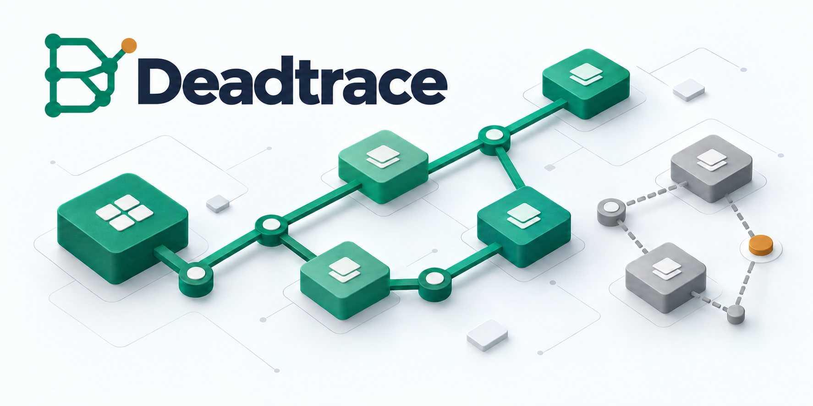
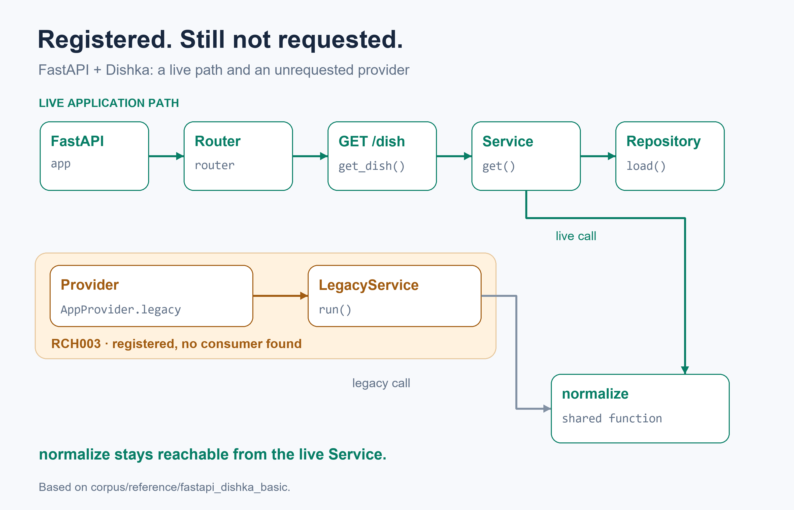
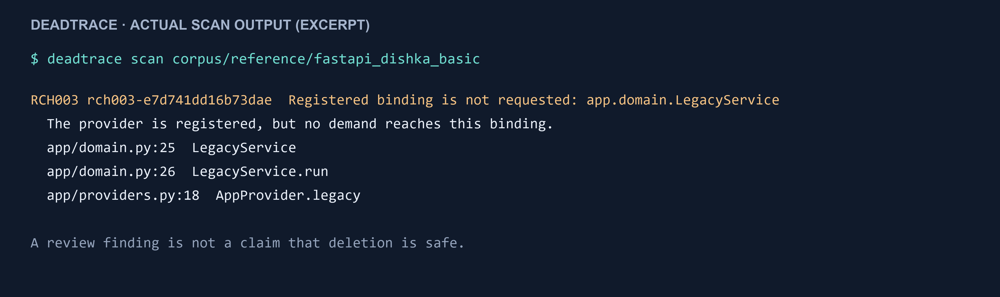
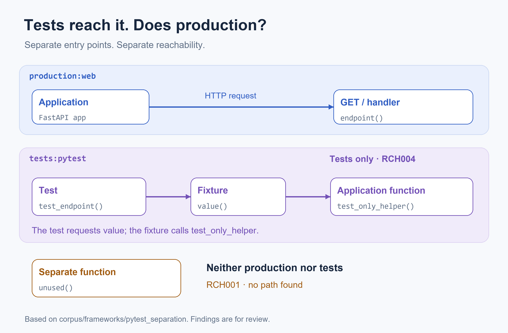

<h1 align="center">Deadtrace</h1>

<p align="center">
  <strong>Find the code your Python application no longer reaches.</strong><br>
  Follow framework registrations, dependency injection and tests back to the application.
</p>

<p align="center">
  <a href="https://github.com/kiselas/deadtrace/actions/workflows/ci.yml"></a>
  <a href="https://pypi.org/project/deadtrace/"></a>
  
  <a href="LICENSE"></a>
  
</p>

<p align="center">
  <a href="#quick-start">Quick start</a> ·
  <a href="#see-what-a-finding-means">See a finding</a> ·
  <a href="#for-developers-and-ai-coding-agents">AI workflow</a> ·
  <a href="#github-action-and-pre-commit">CI</a> ·
  <a href="docs/support-matrix.md">Support matrix</a> ·
  <a href="ROADMAP.md">Roadmap</a>
</p>

<p align="center">
  
</p>

An endpoint may have no ordinary callers and still serve requests. A DI provider may be
registered and never requested. Tests may keep calling an implementation that production
has stopped using.

Deadtrace models those relationships and turns them into explained review findings.
It reads source and configuration without importing or running the application.

## Quick start

With [uv](https://docs.astral.sh/uv/) and CPython 3.12–3.14:

```console
uv tool install --python 3.12 "deadtrace==0.1.0a6"
deadtrace scan .
```

> [!TIP]
> Start with `deadtrace doctor .` to see the discovered applications and analysis limits.
> The scanner does not need to install or import your application's framework dependencies.

## See what a finding means

The [reference FastAPI + Dishka application](corpus/reference/fastapi_dishka_basic) has a live
endpoint → service → repository path. It also registers a legacy provider that no consumer
requests. Both branches call `normalize`, so that shared function must remain reachable.

<p align="center">
  
</p>

Scan that example from a repository checkout:

```console
deadtrace scan corpus/reference/fastapi_dishka_basic
```

<p align="center">
  
</p>

Deadtrace groups the legacy provider, class and method into one `RCH003` finding.
The shared `normalize` function is outside that group.
[Copy the text output](docs/assets/scan-reference.txt).

## Tests can keep old code looking live

A production helper may be called only by a pytest fixture. Deadtrace keeps application
and test worlds separate: that is `RCH004`, while code reached by neither world is `RCH001`.

<p align="center">
  
</p>

The diagram follows the [pytest separation example](corpus/frameworks/pytest_separation).
It explains a review question: is this old code, an unconnected application path, or a root
the analysis has not been told about?

## For developers and AI coding agents

An agent can use the same saved artifacts that a developer reviews:

1. **Scan:** save a JSON report with the affected code, execution worlds and limitations.
2. **Investigate:** use `deadtrace explain` on that report and inspect the listed source.
3. **Change:** prepare a focused patch after checking external consumers and shared code.
4. **Check:** run tests, scan again and compare the reports.

Reports retain the analysis context. Baselines record reviewed findings, and comparisons
distinguish source changes from incompatible model or configuration changes.
The [saved-report workflow](#baseline-and-report-comparison) also works in CI.

> [!IMPORTANT]
> Public alpha: findings are candidates for review, not automatic deletion instructions.
> Unknown behavior can protect code and reduce the number of findings. APIs and artifact
> schemas may change during the alpha series.

## Framework and Python coverage

The strongest dedicated models cover FastAPI, Dishka and pytest. Python references,
entry points, deployment files and conservative framework hooks supply the surrounding
application context. See the [support matrix](docs/support-matrix.md) for the modeled subset.

<details>
<summary><strong>Expand the full capability list and guarded behavior</strong></summary>

- world-local reachability with separate resolved and conservative execution;
- Python references, closures, inheritance and `super()`, method overrides, decorators, and
  evaluated annotations, with conservative protection for values of unknown type and for
  functions registered by decorators of frameworks that are not modeled;
- special methods, hooks that external base classes may call on their subclasses, modules
  and symbols named by strings, and modules imported with `importlib.import_module`;
- module execution by imports anywhere in running code, package initializers, star
  imports, package re-exports, and names bound differently in `try` or `if` branches;
- `@overload` signatures with their implementation, single-underscore library hooks such as
  IPython's `_repr_html_`, and the methods of classes handed to code outside the project;
- deterministic component findings with stable fingerprints;
- FastAPI applications, routers, nested `Depends`, lifespan, selected hooks, background tasks,
  Pydantic hooks, and a bounded `create_app` pattern;
- Dishka `@provide`, class providers, aliases, `from_context`, `FastapiProvider`, `@inject`,
  `DishkaRoute`, multiple applications/containers, and generator cleanup chains;
- a separate pytest world that resolves fixtures, parametrization, `patch` arguments,
  `pytest_plugins`, imported fixtures, hooks, inherited test methods, and the configured
  `python_files`, `python_classes`, and `python_functions` the way pytest does;
- conservative property/protocol/metaclass hooks and historical Django `RunPython` retention;
- Django settings as application roots: installed applications' `models`, `admin`, template
  tags, management commands, and `AppConfig`, the ASGI and WSGI modules, relocated
  migrations, and the modules settings name by string; nested `Meta` and Pydantic `Config`
  classes; Alembic environments and revisions;
- PEP 621, Poetry, flit, and `setup.cfg` console, GUI, and plugin entry points as statically read, provenanced production roots,
  including values such as a Typer application, and the hooks and fixtures of `pytest11`
  plugins; Typer and Click commands;
- automatic worlds when none are configured: scripts with a main guard and `__main__`
  modules, applications of Flask, Celery, Starlette, Litestar, aiohttp, Sanic, Quart,
  Falcon, Bottle, Typer, and FastStream, taskiq schedulers, arq workers, database migrations,
  uncalled FastAPI factories, Celery task autodiscovery, programs that Compose files,
  Dockerfiles, `Procfile`s, Makefiles, and shell scripts start, classes that configuration
  files name, and otherwise a library's public API;
- explicit external keep contracts, saved explanations, baselines, report comparison, and CI exit
  policies;
- schema-1 JSON, text output, compatibility guards, and a performance benchmark artifact.

Unknown assembly, conditional activation, Dishka components/decorators, unresolved plugins, and
untested pinned framework versions weaken the affected world instead of generating stronger
negative findings.

Source discovery skips virtual environments, `site-packages`, `node_modules`, and hidden
directories, and names what it skipped. When a scan reports little because unknown
boundaries protect most code, the report names the widest ones and where they are.

</details>

## Install

<details>
<summary><strong>pip, development setup and installed-wheel checks</strong></summary>

Deadtrace runs on CPython 3.12, 3.13, and 3.14. It never imports the project it scans, so the
interpreter that runs it only needs to be new enough to parse that project's syntax (a file with newer
syntax is reported as `DT1001`). With [uv](https://docs.astral.sh/uv/):

```console
uv tool install --python 3.12 "deadtrace==0.1.0a6"
deadtrace --version
deadtrace scan .
```

Or install into a Python 3.12 virtual environment:

```console
python -m pip install "deadtrace==0.1.0a6"
```

For development from this repository:

```console
uv sync --locked --all-groups
uv run deadtrace --help
```

To test the distributable package without importing the source tree:

```console
uv build
uv run --isolated --no-project --python 3.12 \
  --with ./dist/deadtrace-0.1.0a6-py3-none-any.whl deadtrace --version
```

The interpreter is selected explicitly because `--no-project` ignores `.python-version`, and the
default `python` on PATH may be older than 3.12.

Exercise scanning and saved artifacts from the installed wheel with:

```console
uv run --isolated --no-project --python 3.12 \
  --with ./dist/deadtrace-0.1.0a6-py3-none-any.whl python scripts/wheel_smoke.py
```

The smoke script uses a temporary directory, rejects a source-tree package import, and checks
inventory, analysis, determinism, explanations, baselines, comparisons, and no target execution.

</details>

## Quickstart: FastAPI + Dishka

The reference application contains a live endpoint → service → repository path and one registered
but unrequested legacy binding:

```console
uv run deadtrace scan corpus/reference/fastapi_dishka_basic
uv run deadtrace scan corpus/reference/fastapi_dishka_basic \
  --format json --output deadtrace-report.json --require-complete
uv run deadtrace explain RCH003-FINGERPRINT --report deadtrace-report.json
```

Use the exact fingerprint printed by the scan. `explain` reads only the saved report, so changing
the project cannot silently change the explanation.

### Configuration

```toml
[tool.deadtrace]
require-complete = true
exclude = ["testdata/**"] # data the project never runs; excluded code protects nothing
report-exclude = ["generated/**"] # affects presentation, never the source universe
max-steps = 100000 # optional; by default the budget is sized from the graph

[[tool.deadtrace.worlds]]
profile = "production"
scenario = "web"
roots = ["app.main:app"]
frameworks = ["python", "fastapi", "dishka", "pydantic"]

[[tool.deadtrace.keep]]
target = "app.plugins:external_hook"
reason = "Loaded by the deployment platform"
profiles = ["production"]
```

A world's `frameworks` list is declarative (ADR-0014): it records the frameworks the world is
expected to use, while every capability applies to every world, since switching one off could
only remove protection. Unknown names are rejected.

External keeps propagate conservatively through the callback body. They do not become fabricated
resolved calls and are not equivalent to hiding a warning.

## Findings and exit codes

| Code | Meaning |
| --- | --- |
| `RCH001` | Unreached semantic component in complete production worlds |
| `RCH002` | Route on a router not published by a modeled application |
| `RCH003` | Registered Dishka binding with no established demand |
| `RCH004` | Production code reached only from a complete pytest world |

Exit code `0` means the command completed; limitations may still be present. `1` is emitted only by
an explicitly selected finding policy (`--fail-on-findings`, `--fail-on-new`). `2` means an
operational error or a failed completeness/comparability requirement, and takes priority over `1`.

### Report size

The JSON report gives each world's reached definitions as counts; `--world-members` lists them.
Limitations common to every world appear once under `shared_limitations`, and `DT2002` guards are
grouped by message with an `origins` count unless `--world-members` is set.

### Blocked findings

Some forms of finding were mostly false when public projects were reviewed by hand, so they are
held back by default rather than shown as dead code. A blocked finding keeps its code and
fingerprint; the JSON report lists it under `blocked_findings` with its reasons, and
`--show-blocked` prints it in text output. Exit codes, baselines, and comparisons use only the
findings that are shown.

| Reason | What it covers |
| --- | --- |
| `external_base_hooks` | A method of a class whose base the project does not define, which frameworks call by name |
| `non_production_area` | Code under `examples`, `docs`, `scripts`, `tools`, `benchmarks`, `demo`, `samples` |
| `public_api` | A public name of a public package module, when the project documents its API or lists the name in `__all__` |
| `mentioned_in_config` | A name that a YAML, TOML, INI, template, Makefile, or Dockerfile of the project mentions |
| `interface_declaration` | A stub or abstract method (`pass`, `...`, `raise NotImplementedError`) that a subclass in the project overrides |
| `type_check_input` | Code under a test directory in a `typing`, `type_checking`, `typecheck`, or `typesafety` directory or module, which a type checker reads instead of running |

RCH002 and RCH003 come from a framework model and are never blocked.

## Baseline and report comparison

A baseline records reviewed debt without removing findings from the report or changing the graph:

```console
uv run deadtrace baseline create deadtrace-report.json \
  --output deadtrace-baseline.json --reason "reviewed before adoption"
uv run deadtrace scan . --format json --baseline deadtrace-baseline.json --fail-on-new
```

Refreshing a baseline keeps only exact reviewed entries and does **not** accept new findings unless
that decision is explicit:

```console
uv run deadtrace baseline update deadtrace-baseline.json deadtrace-report-new.json \
  --output deadtrace-baseline-refreshed.json
uv run deadtrace baseline update deadtrace-baseline.json deadtrace-report-new.json \
  --output deadtrace-baseline-reviewed.json --accept-new --reason "reviewed new debt"
```

Compare two reports directly; Git access is not required:

```console
uv run deadtrace compare before.json after.json --fail-on-new --require-comparable
```

Changing the model revision, configuration, capabilities, or the support of target dependency
versions produces `partially_comparable`, not a misleading “all findings resolved” result.
Reports without a common execution world are `incomparable`; incomplete inputs can never be
`comparable`. Added tests, routes, scripts, and applications are source changes: added and
removed source files, worlds, and roots are listed separately from finding changes, and a
baseline stays comparable across them. Fingerprints depend on a finding's code and members only.
When a new model revision makes a baseline incomparable, `baseline update` carries reviewed
entries over by code and members.

A smaller count is not by itself evidence that code was removed or used. Each resolved finding in a
comparison carries a `resolution`: `deleted`, `reached` from a named caller, `kept` by a contract,
`protected` when it may now run only through an unknown boundary such as a computed `getattr`, or
`regrouped`/`blocked` when it is still reported in another form. The causes that need the graph
come from the later scan: run it with `--baseline` made from the earlier report, and it records
them under `baseline.stale_entries`; otherwise they stay `unattributed`. A protected entry tells
whether the boundary alone keeps the code (`sole`) and, in `compare`, whether the boundary is new.
This is a proposal under evaluation (ADR-0122).

Create an inspectable troubleshooting artifact without source text, file paths, symbol names,
configuration values, environment variables, or object values:

```console
uv run deadtrace support-bundle .
uv run deadtrace support-bundle . --output deadtrace-support.json
```

When `--output` is used, Deadtrace prints a privacy/content preview before writing the bundle.

## GitHub Action and pre-commit

A composite action in this repository runs a scan in a workflow. It installs an exact PyPI
version with uv, so the analyzed project is not imported:

```yaml
jobs:
  dead-code:
    runs-on: ubuntu-latest
    steps:
      - uses: actions/checkout@v7
      - uses: kiselas/deadtrace@v0.1.0a6
        with:
          baseline: deadtrace-baseline.json
```

Inputs: `path` (default `.`), `baseline` (fail only on findings it does not accept),
`fail-on-findings`, `version` (an exact release, default the tag's own), and `python-version`
(default 3.12). Pin the action to a release tag.

For pre-commit, the repository publishes two hooks, `deadtrace` (needs `deadtrace-baseline.json`)
and `deadtrace-report` (fails on any finding):

```yaml
repos:
  - repo: https://github.com/kiselas/deadtrace
    rev: v0.1.0a6
    hooks:
      - id: deadtrace
        language_version: python3.12
```

## Supported and guarded behavior

The oracle environment currently pins FastAPI 0.141.1, Dishka 1.10.1, and HTTPX 0.28.1. The
modeled subset is supported for FastAPI `>=0.100,<1` and Dishka `>=1.0,<2` (ADR-0018): an exact,
different version found in `uv.lock` or `pyproject.toml` inside the range is reported as `DT4002`,
and one outside it creates `DT4001` and blocks strong negative findings. An unpinned dependency is
not presented as version-verified.

A pattern for which a complete world reports code that may run as unreached is a contract
violation. It is recorded under [fixtures/known-violations](fixtures/known-violations/README.md)
before it is fixed. Recorded cases, including receiver-flow violations across branches and loop
iterations fixed in model revision 23, now live in `corpus/`. A method whose name is also used on a value of unknown type is protected
rather than reported, and a function under an unmodeled framework's decorator is protected in
any world that loads its module. The methods of a class with an external base, other than
builtins, `abc`, `typing`, `pydantic.BaseModel`, and `dishka.Provider`, are protected once the
class is used, and so are the methods of a class handed to code outside the project.

Dishka conditional activation and components/decorators are detected but guarded. Dynamic imports,
unrestricted reflection, implicit descriptors/metaclasses, arbitrary pytest plugins, and general
Python dispatch are not claimed as fully modeled; known project hooks are protected transitively.
Static Django `RunPython` callbacks are a safety-only retention capability, not Django application
support. Dynamic package entry points are not executed; they emit `DT4102`, while explicit worlds
remain a deterministic override. Run `deadtrace doctor PATH` to see the capability and limitation
state for each world.

## Corpus and development

```console
uv run deadtrace cases validate fixtures/cases
uv run deadtrace cases validate corpus
uv run ruff check .
uv run ruff format --check .
uv run mypy
uv run pytest --cov
uv run deadtrace benchmark corpus/reference/fastapi_dishka_basic --runs 5
uv build
```

`corpus/` contains executable semantic projects with independent expectations for worlds, findings,
limitations, and target states. Oracle tests execute only the trusted included reference project;
ordinary `scan` never imports or executes target modules and does not use the network.

## Project documentation

The canonical implementation plan is [ROADMAP.md](ROADMAP.md). Architecture decision records are
in [docs/adr](docs/adr/README.md), including [inherited Django fixture hooks](docs/adr/0112-inherited-django-fixture-hooks.md)
[AST attribute storage](docs/adr/0115-compact-ast-attribute-storage.md),
[nested import traversal](docs/adr/0116-statement-only-nested-import-walk.md),
[slotted AST storage](docs/adr/0117-slotted-ast-storage.md),
[shared module syntax traversal](docs/adr/0118-shared-module-syntax-walk.md),
and [local Cookiecutter extension roots](docs/adr/0119-cookiecutter-local-extensions.md).
The [analysis contract](docs/analysis-contract.md),
[architecture](docs/architecture.md), [support matrix](docs/support-matrix.md), and
[release acceptance](docs/releasing.md) define this alpha's scope and verification. Repository policies are
in [CONTRIBUTING.md](CONTRIBUTING.md), [SECURITY.md](SECURITY.md),
[GOVERNANCE.md](GOVERNANCE.md), and [CODE_OF_CONDUCT.md](CODE_OF_CONDUCT.md).

The [2026-10-01 repository audit and improvement plan](docs/audit-2026-10-01.md) records current
verification and remaining priorities. [Methodology](docs/methodology.md) is a reviewed research
proposal; it does not change the active milestone or authorize future target execution.

## License

Apache License 2.0. See [LICENSE](LICENSE).

## Feedback

Try Deadtrace on your application and [open an issue](https://github.com/kiselas/deadtrace/issues)
with a small reproducer and the relevant output. Useful findings, false positives and missing
framework patterns all help guide the next improvements.

Follow the project and my other developer tools [on Telegram](https://t.me/kisel_it).

## More projects

Other projects I am building around coding agents:

- [ComputeForGood](https://compute-for-good.tech) — contribute spare coding-agent capacity to useful open-source work. [Source](https://github.com/kiselas/compute_for_good).
- [Testence](https://github.com/kiselas/testence) — browser testing for AI agents with deterministic replay and evidence-backed results.
